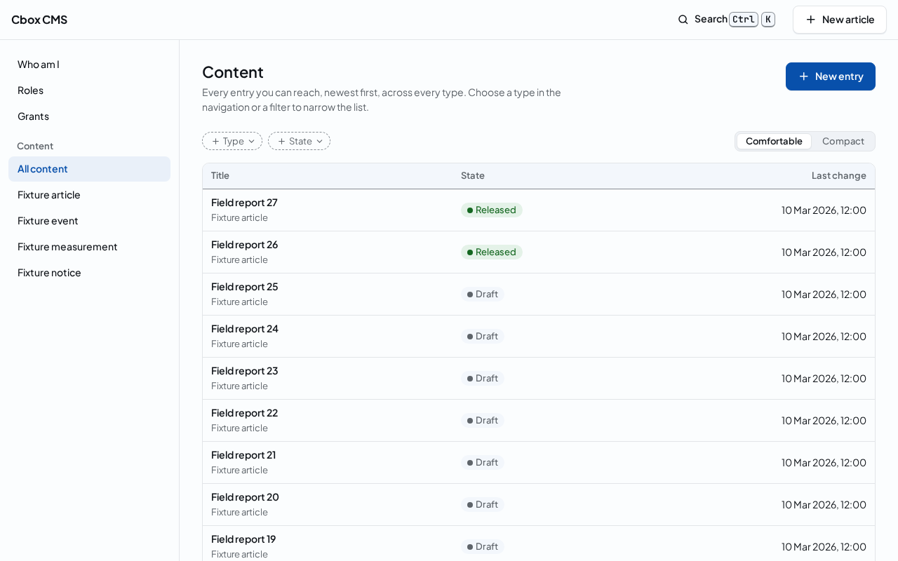
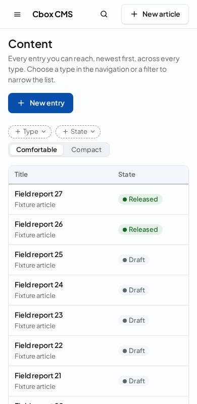

# Working with content

The content list shows the entries you can reach, the newest first. Open it from the Content section of the navigation: All content lists every type, and below it each type of your installation has an entry of its own, named by the type, which lists that type alone. The section shows the types your access lets you see.

Each row shows the entry by its title, the field its type names as its title, and below it the type. An entry whose draft has no title yet shows as Untitled. The pill says the entry's state: Draft until its shared version is released, Released once it is, and Withdrawn when the release was taken back; an archived or removed entry says so instead. The last change is the newest of when the entry was created, revised, released or withdrawn, in your time zone.

## Narrowing the list

The filter chips above the list narrow it. Type opens the list of the type you choose, as its entry in the navigation does; State keeps the entries in the state you choose. A chip with a value shows it, and its cross clears it. The chips are part of the page's address, so a filtered list can be bookmarked, shared with a colleague who has the same access, or opened again.

Comfortable rows show the type below the title; compact rows fit more entries on the screen and show the type in a column of its own. The panel remembers your choice in this browser.

## Pages of the list

The list shows 25 entries at a time. Next shows the entries after the last one shown, and Previous goes back through the pages you opened. While a page loads, the list says so.

On a phone the navigation folds away behind the menu button, and the list shows each entry's title, type and state:

## When the list is empty or cannot be read

A type without entries, or a filter that keeps none, shows an empty list. When you may create entries, it offers New entry, which opens the form that creates one; otherwise it says how to get access. When the server refuses to read the list, the page says why and what to do, with the error's code; when it gets no answer it can read, it asks you to reload.
