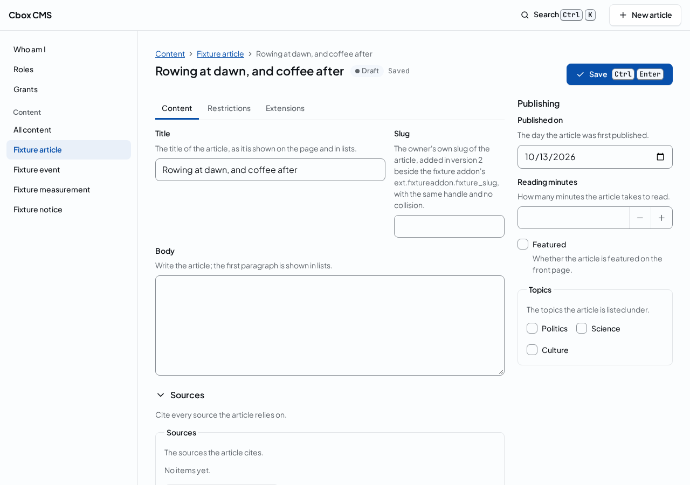
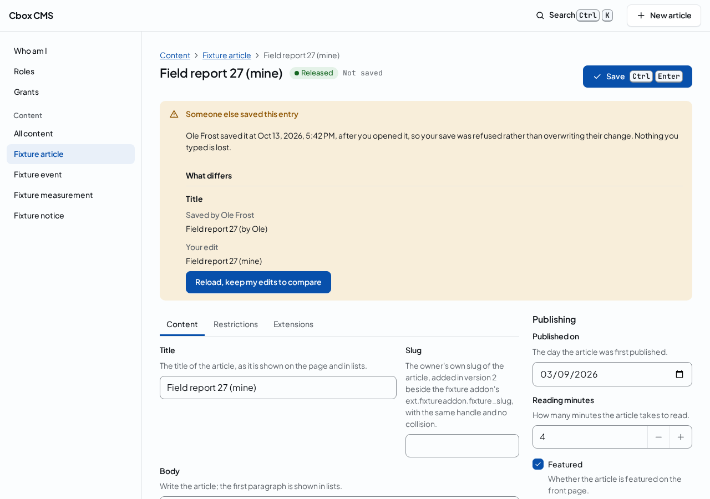
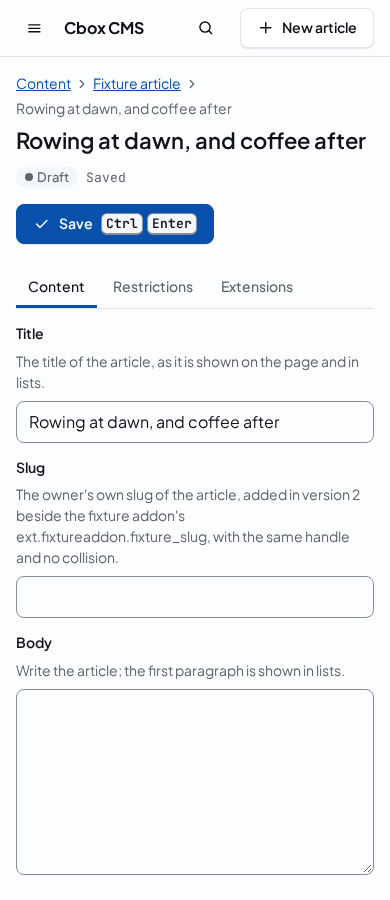
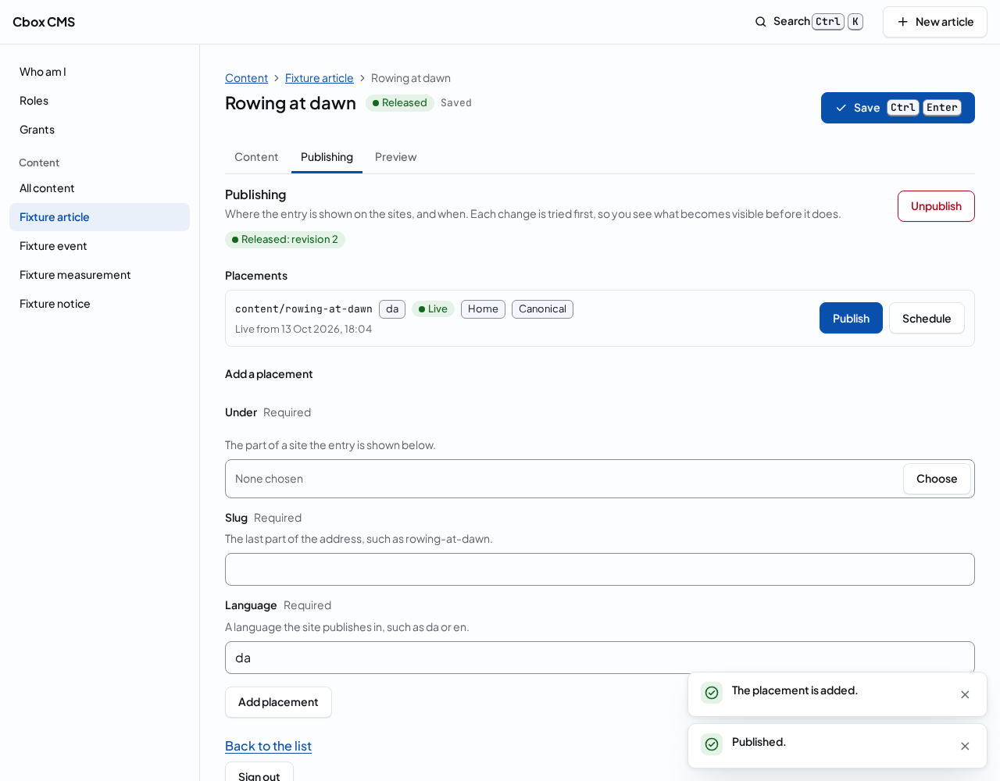
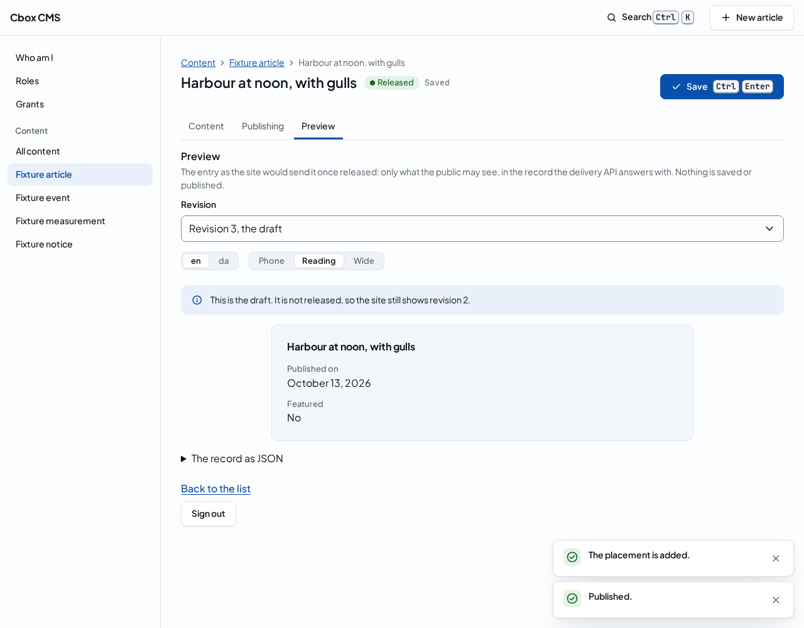

# Working with content

The content list shows the entries you can reach, the newest first. Open it from the Content section of the navigation: All content lists every type, and below it each type of your installation has an entry of its own, named by the type, which lists that type alone. The section shows the types your access lets you see.

Each row shows the entry by its title, which opens the entry in the [entry editor](#editing-an-entry), the field its type names as its title, and below it the type. An entry whose draft has no title yet shows as Untitled. The pill says the entry's state: Draft until its shared version is released, Released once it is, and Withdrawn when the release was taken back; an archived or removed entry says so instead. The last change is the newest of when the entry was created, revised, released or withdrawn, in your time zone.

## Narrowing the list

The filter chips above the list narrow it. Type opens the list of the type you choose, as its entry in the navigation does; State keeps the entries in the state you choose. A chip with a value shows it, and its cross clears it. The chips are part of the page's address, so a filtered list can be bookmarked, shared with a colleague who has the same access, or opened again.

Comfortable rows show the type below the title; compact rows fit more entries on the screen and show the type in a column of its own. The panel remembers your choice in this browser.

## Pages of the list

The list shows 25 entries at a time. Next shows the entries after the last one shown, and Previous goes back through the pages you opened. While a page loads, the list says so.

On a phone the navigation folds away behind the menu button, and the list shows each entry's title, type and state:

## When the list is empty or cannot be read

A type without entries, or a filter that keeps none, shows an empty list. When you may create entries, it offers New entry: in the list of one type it opens the entry editor of a new entry of that type, and across every type the form that creates one; otherwise it says how to get access. When the server refuses to read the list, the page says why and what to do, with the error's code; when it gets no answer it can read, it asks you to reload.

## Editing an entry

The entry editor shows an entry by its title, with its state and what happened to your last save beside it, and below them the form of the entry's type: its tabs, its sections and, on a wide screen, its sidebar. Once the entry is saved, the editor has three views of it: Content, the form; [Publishing](#publishing-an-entry), where it is shown and when; and [Preview](#previewing-an-entry), what the site would show. Open an entry from the content list by its title, or start a new one with New entry in the list of its type.

A new entry first asks where in the site it belongs: choose the part of the site in the tree, and who may edit the entry follows from there. Fill in the fields; a field that needs a value or takes a certain form says so once you change it.

Save, or press ⌘↵ on a Mac and Ctrl+Enter elsewhere, saves your changes. The status beside the entry's state says Saving while it runs, then Saved, or Saved with a note that the site is still being updated, which is no failure. A new entry's page becomes the page of the entry once it is saved. Saving the same change twice never makes two copies.

When the entry cannot be saved, the status says Not saved, each problem is shown at its field and listed above the form with a link to the field, and nothing of what you typed is lost: correct what is marked and save again. When the panel gets no answer, it says so and keeps your changes, so you can save again.

### When someone else saved first

When someone else saved the entry after you opened it, your save is refused rather than overwriting their change. The page says who saved it and when, and lists each field where what they saved differs from your edit, their value above yours. Reload, keep my edits to compare puts their version in the form and keeps your edits beside it: Use my edit brings back your edit of one field, Use all my edits brings back every one, and Save then saves on top of their version. The name is shown when you may see who the person is, which needs a role that may list the staff; otherwise the page says someone else saved.

### Leaving and coming back

While you have changes that are not saved, the panel asks before you leave them. Opening another page from the search asks in the panel, with Stay and Leave and discard; a link or closing the tab asks through the browser. The browser also keeps your unsaved changes of each entry for seven days, so a reload, a crash or a closed tab does not lose them: when you open the entry again, the editor offers to restore them. It offers them only while the entry is as it was when you made them; once someone has saved the entry since, they are discarded, because they were made on a version that is gone. Signing out from the editor removes everything the browser kept, and a browser that keeps nothing, such as a private window with storage blocked, simply offers nothing.

On a phone the form takes the whole width, the sidebar comes after the tabs, and the Save button sits below the title:

When you may read an entry but not change it, the editor shows it and says who can give you the permission to save. An entry you cannot reach, or of a type you cannot see, is not shown; the page says why and leads back to the list. A type that keeps a version of each entry per language is edited with the commands for languages until the editor has its language tabs.

## Publishing an entry

Publishing shows whether the entry is released, and every placement of it: an address on a site, written as the part of the site it sits under and its slug, in a language. Each placement says whether it is live, scheduled, hidden, expired or withdrawn, and when it is live. The placement below the entry's own place in the site is marked Home, and the one search engines are told to use is marked Canonical.

To give the entry an address, use Add a placement: choose the part of a site in the tree, give a slug, the last part of the address, and the language, such as da or en. A slug that another entry already has there is refused, and the page says so.

Publish puts a placement live from now and releases the draft with it, so the site shows what you saved last. Schedule asks for a start, an end or both, in your own time zone, and keeps the placement hidden until the start. Unpublish takes the release back and closes every placement that shows the entry, now or later. Each of them is tried first, and nothing changes until you confirm: the page lists the addresses that would become visible and how many things the change touches. When the change is refused, the page says why; when it gets no answer, trying again never makes the change twice.

## Previewing an entry

Preview shows the entry as the site would send it once released: only the fields the public may see, labelled and written in the language you choose, at a phone's width, at reading width or wide. It shows the draft, with a note when the site still shows an earlier revision, and Revision shows any earlier one. Below the document is the record itself, the JSON the site's API answers with. Previewing saves nothing, publishes nothing and changes nothing the site shows.

